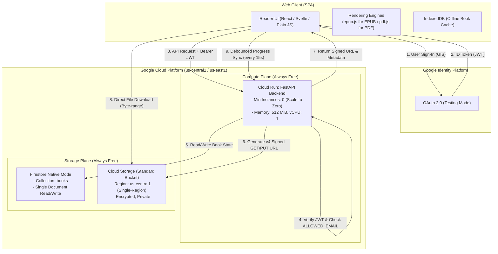
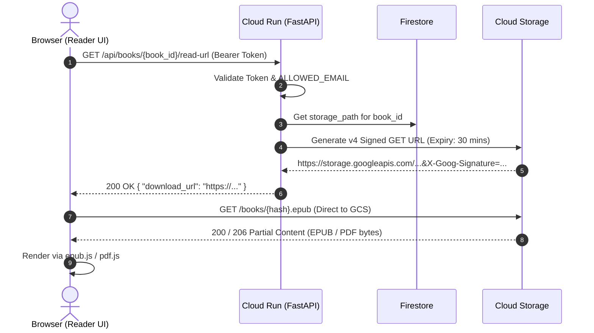
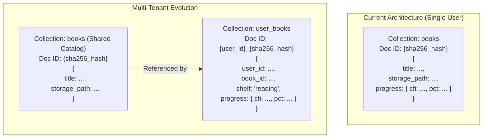

# Technical Design Document: Cloud-Synced Personal Reader
**Target Audience**: Single User (Personal Library)  
**Primary Platform**: Web (Desktop & Mobile Browser)  
**Author Role**: Solutions Architect & Data Systems Designer  
**Status**: Ready for Implementation  

---

## 1. Executive Architecture Overview

The system is designed as a lightweight, serverless cloud-synced reader for EPUB and PDF files. The architecture prioritizes:
1. **Always-Free Operation**: Zero base monthly cost by staying strictly inside GCP's permanent free tier allowances.
2. **Direct-to-Client File Delivery**: Cloud Storage serves files directly to the browser via short-lived v4 Signed URLs, avoiding costly compute proxying and double egress.
3. **Decoupled API Backend**: A Python FastAPI container on Cloud Run acts as the control plane (auth verification, metadata extraction, signed URL minting, progress synchronization) while delegating bulk data transport to GCS.
4. **Relational-Compatible NoSQL**: Firestore in Native Mode structured with clean primary keys (content hashes) that translate cleanly to relational schemas if migrated later.

### 1.1 System Architecture Diagram



---

## 2. GCP Component Choices & Always-Free Tier Justification

| Architecture Role | Chosen GCP Service | Alternative Rejected | Free Tier Limit (Permanent) | Why This Choice Fits the Constraint |
| :--- | :--- | :--- | :--- | :--- |
| **(a) File Storage** | **Cloud Storage (GCS) Standard** (`us-central1`) | Cloud Storage Multi-Region, Cloud SQL BLOBs | **5 GB-months** storage, 5,000 Class A ops, 50,000 Class B ops, 100 GB network egress/mo to internet. | Cloud SQL has zero free tier. Multi-Region GCS does *not* qualify for Always Free. Standard storage in a single eligible US region (`us-central1`, `us-east1`, `us-west1`) gives 5 GB permanently free. |
| **(b) Progress DB** | **Cloud Firestore (Native Mode)** (`us-central1`) | Cloud SQL (PostgreSQL/MySQL), Datastore Mode | **1 GiB** storage, **50,000 reads/day**, **20,000 writes/day**, **20,000 deletes/day**. | Cloud SQL costs ~$7–$10/mo minimum (db-f1-micro is not always-free). Firestore Native provides instant JSON mapping, scales to zero cost, and 20k writes/day is ~66 hours of reading even syncing every 12 seconds. |
| **(c) Backend Compute**| **Cloud Run (Fully Managed)** | Compute Engine VM (e2-micro), Cloud Functions | **2 Million requests/mo**, **360,000 vCPU-secs/mo** (~100 vCPU-hrs), **180,000 GiB-secs/mo**. | VM management requires OS patching and disk billing ($0.04/GB over 30GB). Cloud Run scales to **0 instances** when idle, spinning up in ~1.5s on demand, consuming $0 when you aren't actively reading. |
| **(d) Auth** | **Google Identity Services (OAuth 2.0)** + Backend JWT Verification | Firebase Auth / Identity Platform with multi-tenant config | 100% Free for standard Google OAuth 2.0 client IDs. | Testing-mode OAuth client ID requires zero verification and zero recurring costs. Backend verifies JWT signature using Google's public keys (`google-auth` library) and enforces single-user access via environment variable. |
| **(e) Frontend Hosting**| **Cloud Run Static Mount** (or **Firebase Hosting**) | Cloud Storage Static Website with Load Balancer | Cloud Run includes free requests. Firebase Hosting: **10 GB storage**, **360 MB/day** egress. | GCS static website requires an external HTTP(S) Load Balancer which costs **~$18/month base**. Serving static assets directly from FastAPI (`app.mount('/', StaticFiles)`) costs $0 and eliminates CORS. |

### 2.1 Critical Free-Tier Caveats & Region Pinning
1. **Region Selection**: You **must** deploy GCS, Firestore, and Cloud Run in one of the specific eligible US regions:
   - Recommended: `us-central1` (Iowa) or `us-east1` (South Carolina).
   - If you deploy GCS in `asia-south1` (Mumbai) or `europe-west1`, **there is no Always-Free storage**; you will be billed from byte 1.
2. **Standard Class Only**: GCS free tier applies only to `STANDARD` storage class. Do not configure bucket lifecycle rules that transition to `NEARLINE` or `COLDLINE`, as they incur retrieval fees and do not get the 5 GB free credit.
3. **Artifact Registry / Container Storage**: GCP gives 0.5 GB free storage per month for container images. A heavy Docker image (>500 MB) will incur ~$0.05/month in storage. We will use a lightweight Python 3.12 alpine or slim image (~120 MB) to stay under this.

---

## 3. Concrete Data Model & File Storage Strategy

As someone with a background in Hive, Oracle SQL, and Spark, you are accustomed to schemas, DDL, acid transactions, partition keys, and query optimizers. In Firestore NoSQL:
- **Collection** = Table
- **Document** = Row (stored as semi-structured JSON, up to 1 MiB)
- **Document ID** = Primary Key
- **No Full Table Scans**: In Oracle, missing an index results in a slow Full Table Scan (FTS). In Firestore, **FTS is prohibited**. Every query must be satisfied by an index, or the query is rejected immediately with an API error.

### 3.1 Storage Strategy: Database vs File Metadata

```
┌────────────────────────────────────────────────────────────────────────┐
│ Cloud Storage (GCS)                                                    │
│ Bucket: gs://my-reader-library-us-central1/                            │
│                                                                        │
│ └── books/                                                             │
│     ├── 9f86d081884c7d659a2feaa0c55ad015a3bf4f1b2b0b822cd15d6c15b0f.epub │
│     └── e3b0c44298fc1c149afbf4c8996fb92427ae41e4649b934ca495991b785.pdf  │
│ └── covers/                                                            │
│     └── 9f86d081884c7d659a2feaa0c55ad015a3bf4f1b2b0b822cd15d6c15b0f.jpg  │
└───────────────────────────────────┬────────────────────────────────────┘
                                    │
                       Keyed by SHA-256 Content Hash
                                    │
                                    ▼
┌────────────────────────────────────────────────────────────────────────┐
│ Cloud Firestore (Native Mode)                                          │
│ Collection: books                                                      │
│ Document ID: 9f86d081884c7d659a2feaa0c55ad015a3bf4f1b2b0b822cd15d6c15b0f│
│                                                                        │
│ (Contains catalog metadata + current reading state)                    │
└────────────────────────────────────────────────────────────────────────┘
```

#### What goes in GCS:
- The raw binary payload (`.epub`, `.pdf`).
- Extracted cover images (`.jpg`, `.webp`) if larger than a few kilobytes, to keep Firestore document sizes minuscule.
- **Naming Convention**: `books/{sha256_hash}.{extension}`.
  - *Data Engineering Rationale*: Content-addressable storage provides natural deduplication. If you upload the same book twice with different filenames, the hash matches, preventing redundant storage usage.

#### What is Derived at Ingest (Extracted by Python backend during upload):
- File size in bytes.
- MIME type (`application/epub+zip` vs `application/pdf`).
- Book title, author, publication language (from EPUB OPF metadata or PDF info dictionary).
- Cover art thumbnail extraction.
- Total page count (for PDFs).

#### What goes into Firestore:
Only metadata and mutable reading state.

---

### 3.2 Concrete Schema Design

We use a single collection: `books`. For a single-user application, denormalizing the `progress` object directly inside the `books` document is the most optimal design pattern.

#### Firestore Document: `books/{book_id}`
*(Primary Key `book_id` = SHA-256 hash of file)*

```json
{
  "book_id": "9f86d081884c7d659a2feaa0c55ad015a3bf4f1b2b0b822cd15d6c15b0f00a08",
  "filename": "Designing_Data_Intensive_Applications.epub",
  "format": "epub",
  "file_size_bytes": 14582910,
  "storage_path": "books/9f86d081884c7d659a2feaa0c55ad015a3bf4f1b2b0b822cd15d6c15b0f00a08.epub",
  "cover_image_path": "covers/9f86d081884c7d659a2feaa0c55ad015a3bf4f1b2b0b822cd15d6c15b0f00a08.jpg",
  "title": "Designing Data-Intensive Applications",
  "author": "Martin Kleppmann",
  "language": "en",
  "created_at": "2026-09-26T17:00:00Z",
  "updated_at": "2026-09-26T17:25:30Z",
  
  "progress": {
    "locator_type": "epub_cfi",
    "locator_value": "epubcfi(/6/14[chapter-4]!/4/2/10/1:0)",
    "percentage": 0.342,
    "last_read_at": "2026-09-26T17:25:30Z",
    "device_info": "Mozilla/5.0 (Windows NT 10.0; Win64; x64)"
  }
}
```

For a PDF document:
```json
{
  "book_id": "e3b0c44298fc1c149afbf4c8996fb92427ae41e4649b934ca495991b7852b855",
  "filename": "spark_the_definitive_guide.pdf",
  "format": "pdf",
  "file_size_bytes": 32100450,
  "storage_path": "books/e3b0c44298fc1c149afbf4c8996fb92427ae41e4649b934ca495991b7852b855.pdf",
  "cover_image_path": null,
  "title": "Spark: The Definitive Guide",
  "author": "Bill Chambers, Matei Zaharia",
  "language": "en",
  "total_pages": 608,
  "created_at": "2026-09-20T10:00:00Z",
  "updated_at": "2026-09-26T15:10:00Z",
  
  "progress": {
    "locator_type": "pdf_page",
    "locator_value": "142",
    "percentage": 0.2335,
    "last_read_at": "2026-09-26T15:10:00Z",
    "device_info": "Mobile Safari / iPadOS"
  }
}
```

### 3.3 Relational Equivalent (For Mental Mapping)

If this were implemented in Oracle or Postgres:
```sql
CREATE TABLE books (
    book_id VARCHAR2(64) PRIMARY KEY, -- SHA-256
    filename VARCHAR2(255) NOT NULL,
    format VARCHAR2(10) CHECK (format IN ('epub', 'pdf')),
    file_size_bytes NUMBER(12) NOT NULL,
    storage_path VARCHAR2(512) NOT NULL,
    cover_image_path VARCHAR2(512),
    title VARCHAR2(512),
    author VARCHAR2(512),
    total_pages NUMBER(6),
    created_at TIMESTAMP WITH TIME ZONE DEFAULT CURRENT_TIMESTAMP,
    updated_at TIMESTAMP WITH TIME ZONE
);

CREATE TABLE reading_progress (
    book_id VARCHAR2(64) PRIMARY KEY REFERENCES books(book_id),
    locator_type VARCHAR2(20) CHECK (locator_type IN ('epub_cfi', 'pdf_page')),
    locator_value VARCHAR2(255) NOT NULL,
    percentage NUMBER(5, 4) NOT NULL, -- e.g. 0.3420
    last_read_at TIMESTAMP WITH TIME ZONE NOT NULL,
    device_info VARCHAR2(255)
);
```

#### Why merge them into one Firestore document?
In Firestore, **pricing is per document operation, not per byte**.
- If normalized into two collections (`books` and `reading_progress`), loading your home screen library of 50 books would require **100 document reads** (50 to read books, 50 to read progress).
- By embedding `progress` inside `books`, loading the dashboard requires **50 document reads** (exactly 1 read per book).
- Updating progress costs **1 write** either way.

---

### 3.4 Key Technical Nuance: EPUB vs PDF Progress Locators

A frequent trap when building e-readers is assuming both formats track progress by "page number".
- **PDF**: Fixed-layout format. Page 42 on desktop is identical to Page 42 on an iPhone.
  - `locator_type`: `"pdf_page"`
  - `locator_value`: `"42"` (stringified integer)
  - `percentage`: `42 / total_pages`
- **EPUB**: Reflowable content format. There is no concept of a fixed "page". Changing the font size, line height, or screen orientation alters the number of visual screens.
  - If you save "page 80", opening it on a phone will land on completely different text.
  - **The Solution**: **EPUB Canonical Fragment Identifier (EPUB CFI)** (W3C Standard).
  - An EPUB CFI looks like: `epubcfi(/6/14[chap04]!/4/2/10/1:0)`. It addresses the exact DOM node and character offset in the unzipped XHTML document.
  - Reader engines like `epub.js` generate CFIs natively when turning pages (`rendition.currentLocation().start.cfi`) and can restore the exact viewport instantly (`rendition.display(saved_cfi)`).
  - `percentage`: Derived using `book.locations.percentageFromCfi(cfi)` to render a 0–100% progress bar on the library grid without needing to parse the full EPUB spine every time.

---

## 4. Step-by-Step Google Cloud Console OAuth 2.0 Setup

Because this is a personal, single-user tool, you can keep the OAuth consent screen in **Testing** mode indefinitely. This bypasses Google's complex App Verification process, security reviews, domain verification, and privacy policy hosting requirements.

### Step 1: Create or Select GCP Project
1. Navigate to [Google Cloud Console](https://console.cloud.google.com/).
2. Select your active project (or create `personal-reader-app`).

### Step 2: Configure the OAuth Consent Screen
1. In the left navigation menu, go to **APIs & Services** > **OAuth consent screen**.
2. **User Type**: Select **External**.
   *(Note: "Internal" is only available for Google Workspace enterprise domains. For personal `@gmail.com` accounts, External is required).*
3. Click **Create**.
4. **App Information**:
   - **App name**: `Personal Book Reader`
   - **User support email**: Select your personal Gmail address.
   - **App logo**: **LEAVE EMPTY** (Uploading a logo triggers verification requirements).
5. **App Domain**:
   - Application home page, Privacy policy, Terms of service: **LEAVE ALL EMPTY**.
6. **Developer Contact Information**:
   - Email addresses: Enter your personal Gmail address.
7. Click **Save and Continue**.

### Step 3: Configure Scopes
1. Click **Add or Remove Scopes**.
2. Select only the three default basic identity scopes:
   - `.../auth/userinfo.email`
   - `.../auth/userinfo.profile`
   - `openid`
3. **DO NOT** select any sensitive or restricted scopes (like Google Drive, Gmail, etc.).
4. Click **Update** and then **Save and Continue**.

### Step 4: Add Test Users (MANDATORY CRITICAL STEP)
In "Testing" status, only accounts explicitly added to the Test Users list are authorized to sign in. Any unlisted Google account attempting login receives an immediate `403 access_denied` error from Google.
1. Under **Test users**, click **+ Add Users**.
2. Enter your personal Gmail address (`yourname@gmail.com`).
3. Click **Save and Continue**.
4. Review the summary and return to the Dashboard. Leave the publishing status as **Testing** (do NOT click "Publish App").

### Step 5: Create OAuth 2.0 Client ID Credentials
1. Go to **APIs & Services** > **Credentials**.
2. Click **+ Create Credentials** > **OAuth client ID**.
3. **Application type**: Select **Web application**.
4. **Name**: `Personal Reader Web Client`.
5. **Authorized JavaScript origins**:
   - Add `http://localhost:8000` (for local backend testing)
   - Add `http://localhost:5173` (or whatever local port your frontend dev server uses)
   - Add your production Cloud Run URL (e.g., `https://reader-api-xyz-uc.a.run.app`)
6. **Authorized redirect URIs**:
   - If using Google Identity Services (GIS) popup or One-Tap, redirect URIs are not strictly required, but you can add `http://localhost:8000/callback` and `https://reader-api-xyz-uc.a.run.app/callback`.
7. Click **Create**.
8. A modal appears showing your **Client ID** (e.g., `123456789-abcdef.apps.googleusercontent.com`) and **Client Secret**.
   - Copy the **Client ID**. This is public and will be embedded in your web frontend.
   - The Client Secret is only needed for server-side auth-code exchange; if using GIS ID token flow, the backend only needs the Client ID to verify the token signature.

---

## 5. End-to-End Application Flows & API Contract

### 5.1 Authentication Enforcement in Backend
The backend does not maintain sessions or cookies. It validates the Google ID token on every API call.

```python
# auth.py (FastAPI Dependency)
from fastapi import HTTPException, Security, status
from fastapi.security import HTTPBearer, HTTPAuthorizationCredentials
from google.oauth2 import id_token
from google.auth.transport import requests
import os

security = HTTPBearer()
GOOGLE_CLIENT_ID = os.environ["GOOGLE_CLIENT_ID"]
ALLOWED_EMAIL = os.environ["ALLOWED_EMAIL"] # e.g. "myname@gmail.com"

def verify_user(credentials: HTTPAuthorizationCredentials = Security(security)):
    token = credentials.credentials
    try:
        # Verifies cryptographic signature against Google's live certs,
        # checks expiry, and validates audience matches GOOGLE_CLIENT_ID.
        idinfo = id_token.verify_oauth2_token(
            token, requests.Request(), GOOGLE_CLIENT_ID
        )
        
        email = idinfo.get("email")
        if email != ALLOWED_EMAIL:
            raise HTTPException(
                status_code=status.HTTP_403_FORBIDDEN,
                detail=f"Access denied: {email} is not authorized."
            )
        return idinfo
    except ValueError as e:
        raise HTTPException(
            status_code=status.HTTP_401_UNAUTHORIZED,
            detail=f"Invalid authentication token: {str(e)}"
        )
```

---

### 5.2 Direct-to-Storage File Download (v4 Signed URLs)

Never stream large EPUBs or 50 MB PDFs through Cloud Run. That wastes Cloud Run CPU allocation time, consumes memory, and doubles your network egress footprint.



#### FastAPI Implementation for Signed URLs:
```python
from google.cloud import storage
import datetime

storage_client = storage.Client()

@app.get("/api/books/{book_id}/read-url")
def get_read_url(book_id: str, user=Depends(verify_user)):
    book_ref = firestore_client.collection("books").document(book_id).get()
    if not book_ref.exists:
        raise HTTPException(status_code=404, detail="Book not found")
    
    book_data = book_ref.to_dict()
    bucket = storage_client.bucket(BUCKET_NAME)
    blob = bucket.blob(book_data["storage_path"])
    
    # Generate short-lived v4 signed URL
    url = blob.generate_signed_url(
        version="v4",
        expiration=datetime.timedelta(minutes=30),
        method="GET"
    )
    return {"read_url": url, "format": book_data["format"]}
```

---

### 5.3 Progress Synchronization & Client Debouncing

A critical requirement is **debouncing**. If the frontend makes an API call on every page flip or scroll event:
- A fast reader skimming 100 pages in 10 minutes makes 100 HTTP requests and 100 Firestore writes.
- If scrolling through a 500-page PDF, continuous scroll events could trigger thousands of API calls.

#### Client Debounce Strategy:
1. Maintain local state in `localStorage` or memory on every page turn immediately.
2. Flush to Cloud Run backend:
   - Every **15 seconds** if progress changed.
   - Immediately when the user closes the reader, navigates to the library view, or on the browser's `beforeunload` / `visibilitychange` event (`document.visibilityState === 'hidden'`).
3. Payload sent:
```json
PUT /api/books/9f86d081884c7d659a2feaa0c55ad015a3bf4f1b2b0b822cd15d6c15b0f00a08/progress
Headers: Authorization: Bearer <id_token>

{
  "locator_type": "epub_cfi",
  "locator_value": "epubcfi(/6/14[chapter-4]!/4/2/10/1:0)",
  "percentage": 0.342
}
```

#### Backend Atomic Update:
```python
from google.cloud import firestore

@app.put("/api/books/{book_id}/progress")
def update_progress(book_id: str, data: ProgressUpdateSchema, user=Depends(verify_user)):
    doc_ref = firestore_client.collection("books").document(book_id)
    doc_ref.update({
        "progress.locator_type": data.locator_type,
        "progress.locator_value": data.locator_value,
        "progress.percentage": data.percentage,
        "progress.last_read_at": firestore.SERVER_TIMESTAMP,
        "progress.device_info": data.device_info
    })
    return {"status": "synced"}
```

---

## 6. Realistic Monthly Cost Breakdown & Quota Cliff Analysis

Exchange rate assumption: **1 USD ≈ ₹84 INR**.

### 6.1 Baseline Cost Profile (1 User, 200 Books ~ 5 GB Library)

Assume an active reading pattern: 2 hours of reading every day, flipping pages, loading books, testing on laptop and phone.

| Service | Metric | Free Tier Quota | Your Estimated Monthly Usage | Cost in USD | Cost in INR |
| :--- | :--- | :--- | :--- | :--- | :--- |
| **GCS Storage** | Data stored | 5.0 GB-months | 4.8 GB | $0.00 | ₹0.00 |
| **GCS Operations** | Class A (Uploads) | 5,000 / month | 25 / month | $0.00 | ₹0.00 |
| **GCS Operations** | Class B (Downloads) | 50,000 / month | 300 / month | $0.00 | ₹0.00 |
| **GCS Egress** | Data downloaded | 100 GB / month | ~3.5 GB / month | $0.00 | ₹0.00 |
| **Firestore** | Storage | 1.0 GiB | ~0.002 GiB (2 MB) | $0.00 | ₹0.00 |
| **Firestore** | Document Reads | 50,000 / day | ~200 / day | $0.00 | ₹0.00 |
| **Firestore** | Document Writes| 20,000 / day | ~480 / day (synced every 15s) | $0.00 | ₹0.00 |
| **Cloud Run** | Requests | 2,000,000 / month| ~15,000 / month | $0.00 | ₹0.00 |
| **Cloud Run** | vCPU-seconds | 360,000 vCPU-s | ~7,500 vCPU-s | $0.00 | ₹0.00 |
| **Cloud Run** | GiB-seconds | 180,000 GiB-s | ~3,750 GiB-s | $0.00 | ₹0.00 |
| **Artifact Registry**| Image Storage | 0.5 GB / month | ~0.15 GB (Python slim) | $0.00 | ₹0.00 |
| **OAuth 2.0 Client** | Identity calls | Unlimited (Testing)| ~10 auth refreshes / mo | $0.00 | ₹0.00 |
| **TOTAL** | | | | **$0.00** | **₹0.00** |

---

### 6.2 Quota Cliff Analysis: Exactly What Triggers Costs

| Resource & Limit | Trigger Point | Unit Cost Beyond Free Tier | Monthly Cost for Overages |
| :--- | :--- | :--- | :--- |
| **GCS Standard Storage**<br>`5.0 GB-month` | Library exceeds 5 GB (e.g. 500 books = **20 GB**) | **$0.020 / GB-month** | Extra 15 GB = **$0.30/mo (₹25.20/mo)** |
| **GCS Standard Storage**<br>`5.0 GB-month` | Heavy PDF library (e.g. 1,500 books = **50 GB**) | **$0.020 / GB-month** | Extra 45 GB = **$0.90/mo (₹75.60/mo)** |
| **Artifact Registry**<br>`0.5 GB-month` | Using bloated `python:latest` image (850 MB) | **$0.10 / GB-month** | Extra 0.35 GB = **$0.035/mo (₹2.94/mo)** |
| **GCS Network Egress**<br>`100 GB / month` | Downloading >100 GB files over internet | **$0.12 / GB** | Exceeding by 10 GB = **$1.20/mo (₹100.80/mo)** *(virtually impossible for 1 reader)* |
| **Firestore Writes**<br>`20,000 / day` | Frontend bug: syncing on scroll without debounce | **$0.18 per 100,000 writes** | 100k extra writes = **$0.18/day (₹15/day)** |

### 6.3 Factoring in the $10/Month Google AI Pro Credit
- Your $10/month credit applies to Vertex AI, Cloud Run, and Gemini API.
- If you run an experimental full-text search feature, summarize book chapters with `gemini-1.5-flash`, or keep Cloud Run warm with `min-instances=1` (costing ~$4–$6/month), the **$10 credit absorbs 100% of it**.
- Note: Google Cloud credits generally **do not cover Cloud Storage storage fees** if credits are restricted to Vertex/Cloud Run/Gemini. However, even if your library reaches 20 GB, your out-of-pocket GCS storage bill is merely **₹25 ($0.30) per month**.

---

## 7. Extensibility Roadmap: Mobile Clients & Multi-User Transitions

### 7.1 Transition Matrix: Cheap Decisions vs Lock-in Traps

| Design Decision | How It Is Designed Now | If You Add a Mobile Client Later | If You Add Multiple Users Later | Lock-in Severity |
| :--- | :--- | :--- | :--- | :--- |
| **API Protocol** | Clean REST API with JSON payloads & Bearer Token | Zero changes. Flutter/Swift uses identical endpoints. | Zero changes. Add `user_id` context. | **None (Cheap)** |
| **Auth Transport** | Standard HTTP `Authorization: Bearer <id_token>` | Mobile Google Sign-In SDK obtains ID token natively and passes it in header. | Move from email env var to database user record lookup. | **None (Cheap)** |
| **File Access** | Short-lived v4 Signed URLs | Mobile client streams directly from signed URL into local disk cache. | Store files under `books/{user_id}/{hash}.epub` to isolate storage. | **None (Cheap)** |
| **Progress Locators**| EPUB CFI & PDF Page Numbers | Standardized. Native mobile reader engines (e.g. Foliate / Readium) read CFIs natively. | No locator format changes. | **None (Cheap)** |
| **Data Schema** | Single `books` collection with embedded `progress` map | Zero changes. Mobile reads same progress object. | **Must migrate schema**: Extract `progress` into a subcollection `books/{id}/users/{uid}`. | **Moderate** |
| **OAuth Consent** | Cloud Console "Testing" Mode (Self only) | Register Android SHA-1 fingerprint / iOS bundle ID in same Console project. | Must submit for OAuth Verification if public, or use Firebase Auth. | **High (if public)** |

---

### 7.2 What Needs to Change for a Future Mobile Client
If you later build a Flutter, React Native, or native Swift/Kotlin client:
1. **Zero Backend Changes Needed**:
   - The API uses standard JSON and Bearer tokens. Mobile apps simply make `GET /api/books` and `PUT /api/books/{id}/progress`.
2. **Native OAuth Registration**:
   - In Google Cloud Console, under **Credentials**, you will add a new client ID for **Android** (providing your package name and SHA-1 signing certificate fingerprint) or **iOS** (providing Bundle ID).
   - The mobile app signs in with Google, gets an ID token, and sends that token to your existing FastAPI backend. The backend verifies it against the new mobile Client ID.
3. **EPUB Rendering on Mobile**:
   - Because you stored EPUB CFIs (`epubcfi(...)`) rather than browser-specific scroll positions, the mobile reader engine (such as Readium or an embedded webview running `epub.js`) will resume at the exact sentence.

---

### 7.3 What Needs to Change for Multi-Tenant (Multiple Users)

If you ever decide to invite friends or family, here is what must change:



1. **Schema Refactoring (The Only Database Change)**:
   - In the single-user model, reading progress lives inside `books/{book_id}`.
   - In multi-user, User A and User B cannot share the same `progress` field.
   - You would create a junction table/collection: `user_books/{user_id}_{book_id}` containing `progress`, `shelf` (reading, finished, want-to-read), and `rating`.
2. **Backend Authorization**:
   - Replace `if email != ALLOWED_EMAIL` with a lookup:
     ```python
     user_record = db.collection("users").document(idinfo["sub"]).get()
     ```
3. **OAuth Verification**:
   - In "Testing" mode, you can manually whitelist up to 100 test user email addresses in Cloud Console. If you want open registration, you must switch the OAuth consent screen to "Production" and complete Google's verification process.

---

## 8. Summary Checklist Before Coding

1. [ ] **GCP Project**: Created in Google Cloud Console.
2. [ ] **Cloud Storage**: Bucket created in `us-central1` with `STANDARD` storage class and Uniform Bucket-Level Access.
3. [ ] **Firestore**: Initialized in `us-central1` in **Native Mode**.
4. [ ] **OAuth Consent**: Configured in "Testing" mode, basic scopes only (`email`, `profile`, `openid`), and your personal Gmail added under **Test Users**.
5. [ ] **Web Credentials**: Created OAuth 2.0 Web Client ID; added `http://localhost:8000` to Authorized JavaScript Origins.
6. [ ] **FastAPI Dockerfile**: Based on `python:3.12-slim` to keep image size < 200 MB, well within Artifact Registry's 0.5 GB free limit.
7. [ ] **Frontend Reader**: Implement client-side debounce (15 seconds) for progress sync.
